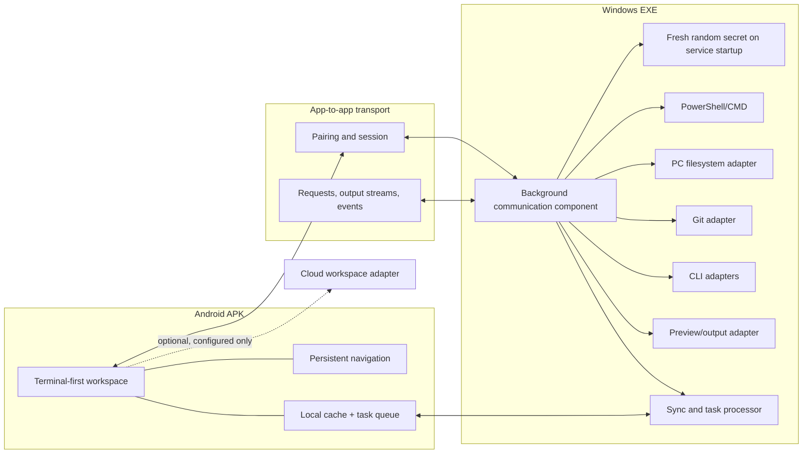

# System Architecture Reference

The canonical architecture specification is in `../modules/05_SYSTEM_ARCHITECTURE.md`. This file is a compact map for quick reading.

## Key boundaries
- The Android app is not a Windows command executor.
- The Windows app owns PC command and file execution.
- Cloud execution, if available, is a separate adapter/environment.
- Offline queueing is not execution.
- No browser-hosted localhost dashboard is part of the product.
- Communication transport is a documented decision, not an assumed framework.
