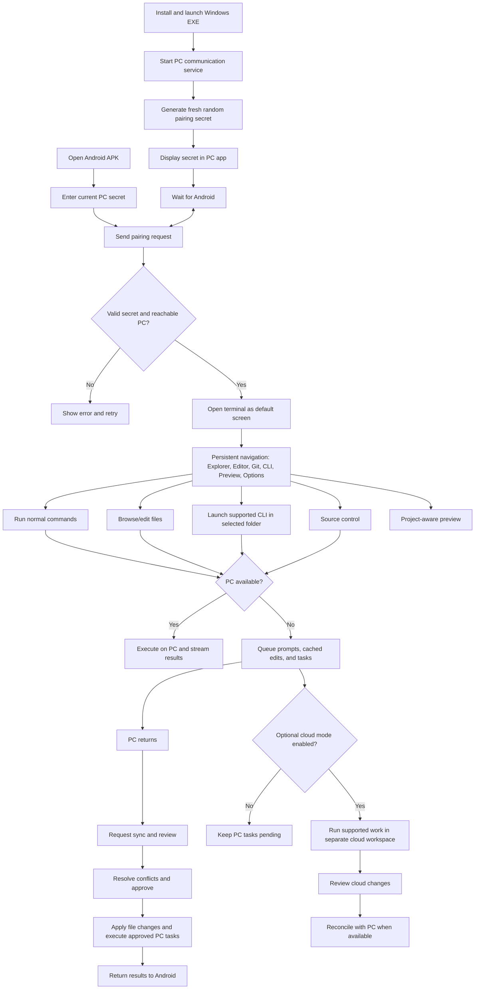

# Approved Workflow Diagram and Workflow Semantics

## Visual reference
`../assets/workflow_diagram.png` is the approved workflow diagram from the conversation. Treat it as the primary visual reference. Preserve it; do not redraw or replace it without user request.

## Flow semantics

## UI-specific correction
The connected Android screen is a mobile interface. Do not draw desktop/macOS traffic-light window controls. The terminal is the default content view, and compact navigation remains available at the top or in a persistent menu.

## Pairing-specific correction
The Windows companion generates a new random secret every time its communication service starts. The Android user must enter the current secret before the session is accepted. A sample key in a diagram is illustrative only.
