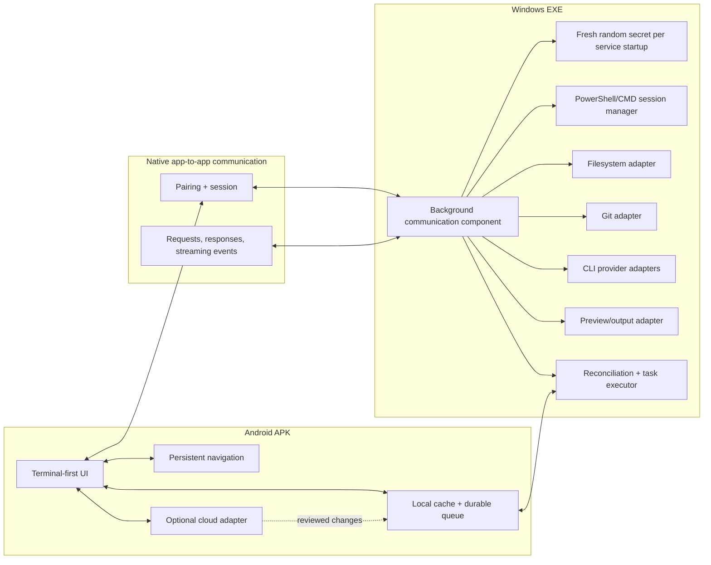

# Module 05 — System Architecture and Component Responsibilities

## 5.1 Architecture goals
- Exactly two user-facing installables: Android APK and Windows EXE.
- No localhost browser dashboard.
- Windows performs local execution.
- Android provides the mobile control/editing interface.
- Offline queue is durable and separate from cloud execution.
- Optional cloud mode does not become a mandatory paid backend.

## 5.2 Logical components

### Android APK
- Connection/pairing UI
- Session state manager
- Terminal UI and output renderer
- Explorer and code editor
- Source Control UI
- CLI launcher UI
- Preview UI
- Local database/cache
- Durable offline task queue
- Sync/reconciliation UI
- Optional cloud provider adapter

### Communication layer
- Pairing/session establishment
- Message transport
- Request/response correlation
- Output/event streaming
- Connection health and reconnect
- Version/capability negotiation
- Error translation

### Windows EXE
- Installer and app lifecycle
- Background communication component
- Secret generation/display
- Session manager
- PowerShell/CMD process manager
- Filesystem adapter
- Git adapter
- CLI provider adapters
- Preview/output adapter
- Sync queue processor
- Diagnostics and logs

## 5.3 Architecture diagram (textual)

## 5.4 Runtime modes
1. **PC connected:** Local PC files and commands are available through the Windows app.
2. **PC unavailable:** Android can work only with cached/local content and queued work; it cannot access live PC files or run PC CLIs.
3. **Optional cloud:** A configured provider may execute supported work remotely. This is not PC mode and may have different files, tools, limits, and authentication.
4. **Reconnect/sync:** Review changes, reconcile conflicts, execute approved PC tasks, return results.

## 5.5 Communication transport decision
Do not choose a transport by habit. Before implementation, compare native transport candidates for:
- Android/Windows compatibility
- Local-network use
- Internet/NAT traversal requirements
- Windows firewall UX
- No browser UI
- Cost and whether relays are required
- Security/maintenance burden
- Streaming terminal output
- File transfer and reconnection behaviour

Document the decision in `state/DECISIONS.md`. Do not introduce a paid relay or localhost web dashboard as a shortcut.

## 5.6 Dependency boundaries
- UI calls typed application services, not shell commands directly.
- Android never constructs arbitrary filesystem paths and assumes they exist on PC without PC validation.
- Provider-specific CLI logic lives behind adapters.
- Cloud provider logic stays separate from PC execution logic.
- Shared protocol definitions should be versioned and validated.

## 5.7 Acceptance
The code structure reflects the component boundaries above, and architecture decisions are documented before networking/execution implementation begins.
