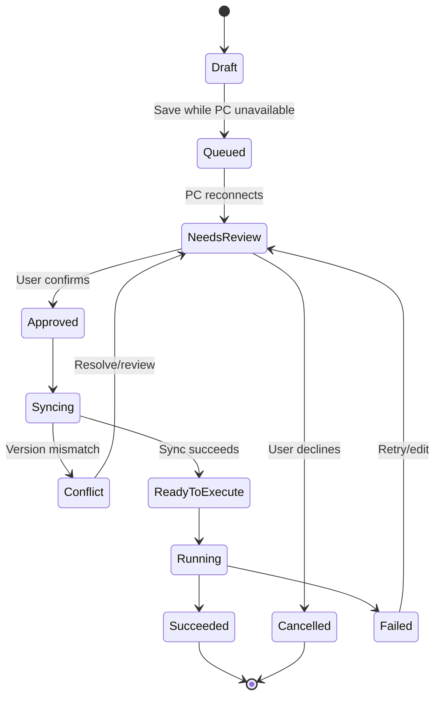

# Module 06 — Communication Protocol, Data Contracts, and State Machines

## 6.1 Purpose
The Android and Windows apps need a predictable contract for pairing, commands, files, Git, CLI sessions, previews, and synchronization. Avoid untyped ad-hoc messages.

## 6.2 Message envelope
Every application message should use a versioned envelope with at least:
- `protocol_version`
- `message_id`
- `request_id` when responding to a request
- `message_type`
- `sent_at`
- `session_id` after pairing
- `payload`
- structured `error` where applicable

Use a typed schema appropriate to the selected stack. Validate incoming messages and reject unsupported protocol versions safely.

## 6.3 Message families
- `pair.request`, `pair.accepted`, `pair.rejected`
- `session.heartbeat`, `session.closed`, `session.capabilities`
- `terminal.start`, `terminal.input`, `terminal.output`, `terminal.exit`, `terminal.cancel`
- `filesystem.list`, `filesystem.read`, `filesystem.write`, `filesystem.rename`, `filesystem.delete`, `filesystem.changed`
- `git.status`, `git.diff`, `git.stage`, `git.commit`, `git.pull`, `git.push`, `git.branch`
- `cli.detect`, `cli.install`, `cli.auth_status`, `cli.launch`, `cli.stop`
- `preview.start`, `preview.status`, `preview.output`, `preview.stop`
- `sync.offer`, `sync.review`, `sync.approve`, `sync.progress`, `sync.conflict`, `sync.complete`
- `task.enqueue`, `task.cancel`, `task.status`, `task.result`
- `error`

These are conceptual names; adapt to chosen conventions while preserving semantics.

## 6.4 Request behaviour
- Requests that mutate files or execute commands must be identifiable and auditable.
- Streaming messages must preserve ordering or carry sequence numbers.
- Duplicate task delivery must not unintentionally execute a task twice.
- Timeouts and retries must be explicit.
- Cancellation must not be reported as success.
- Errors should include a stable code, user-safe message, and optional diagnostic details without secrets.

## 6.5 Task state machine

## 6.6 Conceptual data entities
- `PairingSession`: session ID, created/expiry time, connection state, capability list.
- `TerminalSession`: session ID, shell type, working directory, running state, output sequence.
- `FileChange`: operation ID, relative path, operation, base hash/version, content reference, sync status.
- `QueuedTask`: task ID, task type, project reference, working directory, payload, creation time, approval state, execution state, result.
- `GitState`: repository root, branch, status summary, diff reference.
- `CliSession`: provider ID, executable/capability detection, working directory, process/session state.
- `PreviewSession`: project type, preview method, status, output reference, fidelity label.
- `CloudWorkspace`: provider, workspace reference, quota notice, sync state.

## 6.7 Error taxonomy
At minimum: invalid secret, PC unreachable, protocol mismatch, permission denied, path not allowed, file not found, file changed since read, CLI missing, authentication required, process launch failed, non-zero exit, transport lost, sync interrupted, Git conflict, cloud quota exhausted, and preview unsupported.

## 6.8 Acceptance
Protocol types and task states are implemented and tested. No UI label reports queued work as completed before actual execution.
